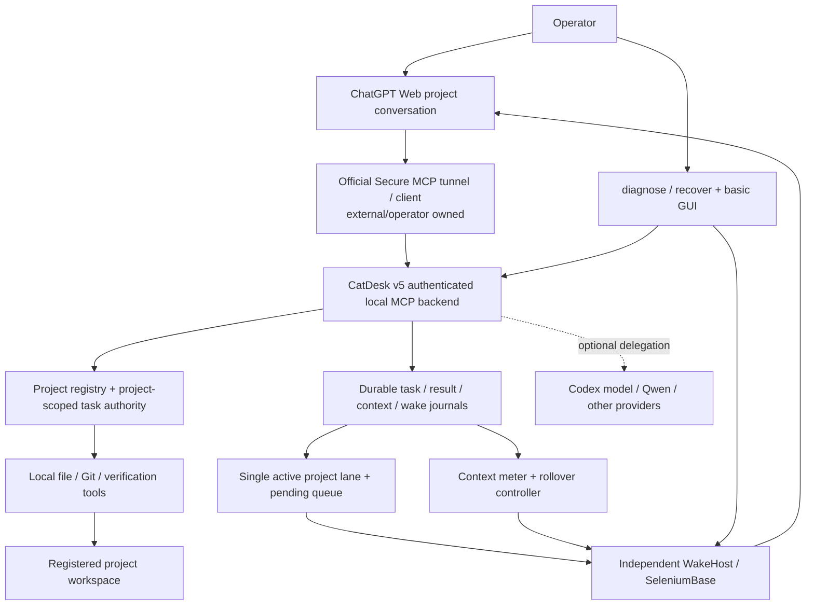

# CatDesk — System Architecture

**Decision 2026-11-16T01:38:56.316414+00:00:** The existing development observer now also accepts the original approved public-review context through its native claim and frozen consent. No competing approval registry, owner, service, profile, tunnel or Wake binding is created. A successful context preflight is not a successful external review or release proof. [Evidence](../verification/APPROVED_REVIEW_CONTEXT_OBSERVATION_2026_11_15.json).

**Decision 2026-11-16T00:34:15.175115+00:00:** Unknown-send diagnostics reuse the existing registered-project inspector and SeleniumBase primitives. No new owner, scheduler, profile, tunnel or authorization system. A real source-candidate no-send observation found one exact USER and complete response; installed production and full task acceptance remain separate. [Evidence](../verification/FROZEN_REQUEST_OBSERVATION_2026_11_15.json).

**Decision 2026-11-16T00:09:22.940282+00:00:** The authorized resource ACL repair and actual installed-interpreter native version check are accepted. They add no backend, connection, release manager or native model dependency. Continue direct-Web acceptance separately; interpreter launch alone is not task verification. [Evidence](../verification/NATIVE_RUNTIME_REPAIR_APPLIED_2026_11_15.json).

**Decision 2026-11-15T22:34:51Z:** Reuse the existing native runner. The verified private-runtime repair is resource-owner read/execute provisioning to existing accounts, not a new backend, policy or execution subsystem. Source development and protected production acceptance remain independent. [Evidence](../verification/NATIVE_RUNTIME_READ_ACCESS_2026_11_15.json).

**Decision 2026-11-15T21:34:58Z:** Readiness and task verification are distinct: existing daemon READY and actual system-command success do not qualify the failed approved interpreter. Reuse the existing owner and diagnostics; no new infrastructure. [Evidence](../verification/NATIVE_SANDBOX_READINESS_AND_COMMAND_QUALIFICATION_2026_11_15.json).

**Decision 2026-11-15T21:01:12Z:** Use the existing command receipt path for advisory native sandbox diagnostics; no new runtime, connection or recovery subsystem. The local verifier failure does not stop unrelated source or Wake work. [Evidence](../verification/NATIVE_COMMAND_FAILURE_DIAGNOSTIC_2026_11_15.json).

**Source validation 2026-11-15T20:32:08Z:** retained proposal operations are now checked against their original full diff hash within the existing non-writing recovery validation. This adds no tool call, replay, authority, install or service. Source `9d96f8e32f3fdf8b528d15eda453e9398f74a392` passes eight native recovery tests and strict checks; selected live test app remains source `79a449b`.

**Decision 2026-11-15T20:23:03Z:** The existing source/build/test lane now demonstrates a scoped local MCP edit and an actual diagnostic Wake plus automatic body readback while production remains unchanged. The failed fixed verifier is a native sandbox dependency, not a global development or Wake blocker. This is partial local/control-plane evidence; real Web-origin editing, verification, checkpoint and self-Wake acceptance remain open. See [dated proof](../verification/SETTLED_READ_ONLY_TASK_RECOVERY_2026_11_15.json).

**Release-model clarification 2026-11-15T19:33:36Z:** one system and one unchanged canonical v5 interface. Frozen independently verified releases are production; authorized source/worktrees/builds and isolated local fixture tests are development. Reuse current selection, immutable artifacts, existing fallback/promotion/rollback and bounded owners. No new installation, release manager, tunnel, plugin, external connection or backend infrastructure. Local source work proceeds independently of protected-release acceptance.

## 2026-11-15T19:18:45Z — Development/production separation decision

Development and production are separate execution realms using the same existing components. Source work, isolated package selection and bounded authenticated development backends do not depend on protected production review/signing. Only shared browser operations require their existing exclusive owner; do not add another launcher, scheduler or browser service. One canonical v5 interface serves ChatGPT Web. Local binaries/MCP harnesses/SeleniumBase tests provide independent development; no duplicate external infrastructure. Full actual Web acceptance remains OPEN until missing installed operations are legitimately qualified. See [dated qualification](../verification/DEVELOPMENT_PRODUCTION_SEPARATION_2026_11_15.json) and [current handoff](../../CATDESK_PROJECT_HANDOFF.md) for exact maturity and remaining gates.

> **Architecture baseline:** 2026-11-14 · **Revision timestamp (UTC):** `2026-11-14T18:47:56Z`  
> **Document status:** Reviewed consolidation; canonical design on integration of PR #8 into development. It is **not** an operational authorization.
> **Product owner requirements:** November 14, 2026. **Code/evidence basis:** the existing `codex/web-rollover-oct17` development line and the documentation consolidation branch, checked November 14, 2026.  
> **Status rule:** Design intent ≠ source implementation ≠ selected binary ≠ installed/live acceptance. The repository's current [handoff](../../CATDESK_PROJECT_HANDOFF.md), [milestones](../../CATDESK_MILESTONES.md), [tickets](../../CATDESK_TICKETS.md), original execution journals and live readbacks determine *current* status.

## 1. Mission and success criterion

**CatDesk makes ChatGPT Web a useful local work agent even when Codex model usage is exhausted.** ChatGPT Web uses an authenticated MCP connection to operate on an assigned local project: inspect files, make authorized changes, run allowed tests/commands, inspect Git results, preserve progress and continue over successive ChatGPT turns. Using a native Codex *model* or Codex development session is **optional**, not a prerequisite. A Codex CLI sandbox/verification utility may be used without consuming a Codex model turn; distinguish the two explicitly.

The successful operator experience is simple: select a project, work through its registered ChatGPT conversation, see its progress, and rely on **one-command recovery**, **clear layer diagnostics**, **safe self-Wake**, and **context-aware chat rollover**. The core workflow must not require the user to repeatedly repair opaque states, copy messages between chats or find the right command inside historical logs.

**Core product outcomes, in priority order:**

1. **P0 Direct Web execution:** real authorized ChatGPT Web → CatDesk v5 → project file edit → independent verification → attributable result, with zero required Codex model calls.
2. **P0 Recoverability:** supported `recover` orchestration restores eligible failed layers; a read-only `diagnose` pinpoints the failed layer and next action if recovery cannot proceed.
3. **P0 Continuity:** one per-turn timer, graceful ~19-minute checkpoint, journaled manual wake, actual SeleniumBase submission/receipt and continued work.
4. **P0 Multi-project serial MVP:** multiple registered projects and distinct current ChatGPT URLs, but only **one active local execution lane**; correct project-specific routing and durable queued work. Parallel local execution is deferred.
5. **P1 Context pressure and rollover:** conservative estimated conversation context, uncertainty, source-authored compact handoff, controlled new-chat creation and verified per-project target switch.
6. **P2 Basic convenient GUI:** preserve the useful Binagotchy look/feel, showing project, URL, status, queue and simple recovery/diagnostics; embellishments later.
7. **Future providers and concurrency:** potentially DeepSeek or other compatible MCP clients, and separately approved parallel project execution.

**Non-goals for the initial MVP:** mandatory native model dispatch, autonomous production self-upgrade, replacing the externally owned secure tunnel, an entirely new agent framework, unrestricted shell access, guaranteed exact ChatGPT model-token counts, or simultaneous local coding across many projects.

## 2. Document ownership: one fact, one home

| Document | Owns; do not duplicate elsewhere |
|---|---|
| **This document** | Product mission, system topology, end-to-end flows, architectural decisions and system-level acceptance contracts |
| [CATDESK_COMPONENTS.md](CATDESK_COMPONENTS.md) | Component responsibilities, interfaces, code pointers, lifecycle/state machines, subsystem acceptance |
| [CATDESK_RELEASE_AND_RECOVERY.md](CATDESK_RELEASE_AND_RECOVERY.md) | `recover`/`diagnose` user experience, failure boundaries, development/production separation, rollback and proofs |
| [CATDESK_SECURITY_MODEL.md](CATDESK_SECURITY_MODEL.md) | Identity, trust boundaries, containment, secrets, authorization, journals, no-replay and abuse cases |
| [Root milestones](../../CATDESK_MILESTONES.md) and [tickets](../../CATDESK_TICKETS.md) | Changing requirements, priorities, dated scope requests, ticket status and acceptance evidence |
| [Root handoff](../../CATDESK_PROJECT_HANDOFF.md) and [activity](../../CATDESK_ACTIVITY_LOG.md) | Current operational snapshot/next action and dated execution audit, respectively |

These four files are deliberately *not* a second milestone board, activity log or command cookbook. Architectural prose should remain stable while milestones change.

## 3. System context and principal components

**Trust and ownership:** The secure tunnel conveys MCP requests but is not a local execution agent. CatDesk validates project/task authority before acting on workspace resources. WakeHost/browser delivery has a separate physical owner and journal. The browser is a delivery channel, **not** proof by itself of task completion. The installed/selected runtime and GitHub source may be different revisions. See [security](CATDESK_SECURITY_MODEL.md) and [release/recovery](CATDESK_RELEASE_AND_RECOVERY.md).

The core technology already present in source includes a Rust MCP/control backend (`src/mcp.rs`, `src/project_mcp.rs`, `src/project_mcp_task.rs`), project registry, task and receipt handling, `src/operator_web_*` workflow modules, the independent Wake runtime (`wake/src/runtime.rs`), SeleniumBase adapter (`scripts/wake_bridge.py`, `wake/adapter.py`), and optional delegated-provider code (`src/delegated/`). A code path existing in source does not establish that it is active in the installed binary.

## 4. Primary operating flow (serial MVP)

1. **Project admission:** The operator registers a project ID, approved workspace/root, conversation URL and current generation/digest. The project may retain prior URLs as history. Project-specific permissions and permitted verification profiles must be known.
2. **Work selection:** A new authorized task enters that project's queue. A single global execution-lane lease selects one active project; other projects remain queued and visible. Read-only diagnostics and recovery safety checks must remain possible when the work lane is busy.
3. **ChatGPT Web execution:** The registered conversation makes scoped MCP tool calls. CatDesk verifies original assignment, workspace, task, execution key and permissions. Real edits and verification are independently recorded; model statements alone do not prove edits, tests or completion.
4. **Turn management:** At the start of the turn, start a CatDesk timer and retain its ID. Check as work proceeds. At the 18-minute soft checkpoint, begin safe cleanup and a compact continuation checkpoint. Aim to finish the work turn and request a wake **near but before 19 minutes**, leaving margin before the fixed 20-minute deadline.
5. **Continue or finish:** If task work is finished, record its verified result and release the active lane. Otherwise, journal one bound manual-wake intent before leaving the turn. A continued project normally retains the lane across successive turns, subject to operator pause/yield and bounded fairness policy.
6. **Wake delivery:** WakeHost opens the *exact* current project conversation with the configured SeleniumBase profile, verifies the target/editor state and submits at most one authorized continuation. Store actual durable attempt and receipt state. UNKNOWN/SUBMITTING is a reconciliation fence, **not** permission to resend.
7. **New turn:** Upon a verified new ChatGPT turn, recheck task, generation and timer; continue from the stored checkpoint and original task identity. An expired ChatGPT conversation may instead transition through the separate rollover flow.

### Serial lane and fairness decision

For this phase, **one active project task at a time** is an explicit product-policy choice, even if distinct ChatGPT conversations can exist concurrently and the backend could technically handle parallel independent calls. Treat this as a scheduling decision, not a claim that OpenAI prohibits simultaneous chats.

A project may retain the lane while requesting successive wakes. The operator must be able to **pause, yield or switch at a safe point**; a failed/blocked project must not permanently lock the queue. A lease has owner and durable state, not merely a PID or chat URL. Two different projects may be registered, observed or diagnosed without parallel mutation authority. Full parallel multi-project coding requires separate design, fairness and isolation acceptance before being enabled.

The earlier project documentation prioritized some independent Web-project concurrency. This November 14 serial-MVP requirement is a **dated operator scope revision**: preserve prior work and tests, but do not require parallel project execution for initial product acceptance. It does **not** relax exact-target or project isolation checks.

## 5. Manual Wake and TurnTimer as separate contracts

- **TurnTimer:** One current-turn timer ID per actual turn. The v5 tool exposes fixed 18-minute soft checkpoint and 20-minute deadline; it does not accept arbitrary target, duration or generation arguments. **~19-minute graceful exit is the conversation operating policy**, not an alteration of the fixed timer semantics.
- **Wake intent:** A durable record of the desire to continue, scoped to project, task/event, target digest and generation. A queue entry alone is not delivery.
- **Wake attempt:** The browser owner holds the single browser lease and revalidates current pairing, editor state, draft and submission boundaries.
- **Wake outcome:** Confirmed appended USER receipt and subsequent response readback are distinct from the original attempt. A time-out or unknown UI outcome must be held for read-only reconciliation and never automatically retried.
- **Continuation:** Correct project and generation, original task state preserved, no second native or file-side effect from an uncertain prior call.

See the [components contract](CATDESK_COMPONENTS.md) for states and [security](CATDESK_SECURITY_MODEL.md) for replay prohibitions.

### Historical acceptance preserved — single-chat Wake and timer

**Historical proof, not a claim of current installed readiness:** An October 10, 2026 CatDesk Chat55 recovery handoff (`docs/orchestrator/CATDESK_CHAT55_RECOVERY_HANDOFF_2026-10-10.md`, "Timings") records a substantive turn whose timer was stopped at **18m56s**. The retained independent Wake status also contains a confirmed CatDesk-bound manual delivery event `manual-wake-mcp-1791760868717`: at **2026-10-11T23:44:41Z** the event reached an `EXACT_USER_MESSAGE_APPENDED` receipt for its original generation-33 target, with a later stored success timestamp at **2026-10-11T23:44:48Z**. The user additionally recalls the end-of-turn/manual-wake workflow functioning for CatDesk chats. These support historical timer use and exact single-chat USER delivery; they do **not** alone prove that this particular turn's timer caused that particular send, or establish a complete installed Web edit → verification → wake → resumed edit cycle.

Record these as **HISTORICALLY_DEMONSTRATED**, not `NEVER_IMPLEMENTED`. Future work should be framed as regression/restore-and-extend: preserve old receipts and timers, requalify them against the current selected image and target, then demonstrate full task continuity and more than one project. On November 14, a fresh Binagotchy status reported WakeHost `STOPPED`/PID 0 while a redacted transport snapshot reported `RUNNING`; treat this as **conflicting observations requiring owner/lease reconciliation**, not a proved running or failed host. No status read authorizes a restart or replay.

## 6. Context-aware chat rollover

The current design is specified in [T-0484](../orchestrator/tickets/T-0484_POST_MULTI_PROJECT_CONTEXT_METER_AUTO_COMPACTION.md). Reuse it, do not replace it with a crude character counter.

Three **distinct** quantities must be shown: **(a)** observed MCP input/output traffic, **(b)** estimated unique active-conversation context pressure, and **(c)** uncertainty/headroom for unknown model metadata, hidden context, attachments and incomplete browser coverage. The legacy `o200k_base` value is an estimator, not exact provider usage. Example local policy of 96k budget, 24k headroom and 8k unknown reserve is **not** proof of the provider's context limit.

When an evidence-qualified threshold is approached, acquire per-project rollover admission, ask the current chat for a task-bound compact handoff, validate the receipt/content without resending a confirmed request, ask the existing browser to create one successor chat, confirm the issued URL and initialized successor, then atomically update the **locally owned paired registry/Wake target state** using generation/hash CAS. Remote browser submission and ChatGPT conversation creation are *not* database-atomic with local state: use a durable multi-stage transaction, hold UNKNOWN outcomes and perform read-only reconciliation. Preserve predecessor URLs and full task/journal history.

Automatic rollover and full model-aware metering are **planned/partially source-tested**; do not claim installed/unattended success from existing controlled examples.

## 7. Acceptance roadmap: outcomes rather than source volume

| Gate | Required proof | Current qualification as of this dated authoring basis |
|---|---|---|
| A. Direct Web work | Real registered ChatGPT Web file edit, actual verification and checkpoint, without native model call | **OPEN / not demonstrated end-to-end** |
| B. Layer recovery | Fault each eligible layer; supported `recover` resumes without new owner or protected-state damage; `diagnose` isolates refusal | **OPEN** for complete system; narrower installed recovery evidence exists |
| C. Turn continuation | Start/check timer, checkpoint near 19 min; actual bound self-Wake USER receipt and resumed work | **OPEN** for complete installed cycle; controlled wake examples exist |
| D. Multiple projects, serial | Two distinct registered URLs/workspaces; one active lane, queued other, exact delivery, no cross-project writes or duplicate sends | **OPEN** for end-to-end installation and scheduling policy |
| E. Rollover | Pressure/uncertainty, source-authored handoff, issued successor, verified initialization, CAS paired bind, restart-safe recovery | **OPEN** for installed/unattended full acceptance; partial controlled evidence exists |
| F. Minimal GUI | Actual desktop UI shows projects, target URLs/status and task/wake controls; no accidental process start | **OPEN** for verified current visible deployment |
| G. Other providers/parallelism | Compatible MCP client and approved project scope, separated per-provider auth and concurrency proof | **FUTURE**, no automatic enabling |

Tests and historical acceptance claims must remain attached to exact commit, selected/installed binary, context, time and scope. For today's operational status consult the five root documents and durable tools, not this table alone.

### Historical milestone lineage to retain

- **2026-07-25:** Early provider-neutral CatDesk-owned worker architecture (T-0013B) selected; OpenClaw no longer a mandatory runtime dependency. This remains architectural history rather than the current mandatory model path.
- **2026-09/10:** Independent WakeHost, scoped targets, guarded SeleniumBase delivery, TurnTimer and recovery underwent source/controlled/live milestones. The October 10–11 timer and exact USER receipt are preserved above.
- **2026-10-17:** Independent ChatGPT Web project continuity and context-aware rollover became core to the multi-project milestone; separate native Codex threads did not constitute its acceptance.
- **2026-11-01:** T-0484 clarified a three-metric context meter: MCP traffic, unique active-conversation pressure, and unknown/headroom. Local 96k/24k/8k values remain policy examples rather than provider facts.
- **2026-11-10:** The direct **Web → v5 → authorized local edit/verification → manual self-Wake** path became the first acceptance requirement, with native model delegation optional.
- **2026-11-14:** The operator set a simpler **single-active-project** initial scheduling target and the four-document architecture governance. This is a new priority choice; previously tested fairness/isolation code and receipts must not be discarded.

Do not transpose original dates into claims of present runtime success. Each transition is substantiated in the historical architecture, T-0484, C0/C1 acceptance, release, Wake and project-handoff documents linked below.

## 8. Architecture decision record and revision policy

| UTC timestamp | Decision | Source of decision | Consequence |
|---|---|---|---|
| `2026-11-14T18:47:56Z` | Adopt four specialized architecture documents, with a single end-to-end architecture authority | Operator November 14 instruction | Migrate canonical material, archive old versions after comparison and reviewed integration |
| `2026-11-14T18:47:56Z` | Prioritize direct Web local work without Codex model usage; serial active project lane for MVP | Operator November 14 requirements and November 10 direct-Web clarification | Optional Codex/Qwen, independent project routing mandatory, parallel project execution deferred |
| `2026-11-14T18:47:56Z` | Require one-command recovery, passive diagnosis, manual Wake, timer-based handoff, T-0484 rollover | Operator November 14 requirements | Update milestone/ticket acceptance; do not assert functionality already installed |
| `2026-11-14T18:47:56Z` | GUI basic status is lower priority; other providers future | Operator November 14 requirements | Do not block core acceptance on UI polish/DeepSeek integration |

**Change discipline:** Every *material architecture change* adds an ISO 8601 UTC entry with: problem, original requirement, revised decision, alternatives/tradeoffs, affected components, version/commit, accepted evidence, related milestone/ticket, reviewer and superseded reference. Do **not** prepend operational task logs here. For a new feature idea, first create/change a dated milestone and ticket; update architecture only when the system boundary/contract changes. Maintain archives byte-faithfully; preserve provenance and mark old content `HISTORICAL` rather than deleting it. No AI may promote source maturity or grant runtime permissions by changing prose.

### QA revision record

- **2026-11-14T21:28:42Z:** Review for PR #8 corrected Windows lifecycle syntax and backend/tunnel endpoint attribution. Root status tracks the ACTIVE product goal; no installed or live gate is newly accepted.
- **2026-11-14T19:07:55Z:** Preserved historical TurnTimer and exact single-chat Wake evidence, documented conflicting current WakeHost status projections, and added a concise provenance timeline. No new runtime authority or acceptance claim.

### Adoption and retained history

1. All four files reviewed against development `a1fbd1a` and the November 14 read-only baseline; 51 architecture links checked. The integration adds no runtime authority.
2. The architecture index now designates this file as primary and the other three as focused references; the prior canonical file retains its content behind a supersession notice.
3. Preserve `docs/orchestrator/CANONICAL_CURRENT_ARCHITECTURE.md`, the November 7 proposed revision, old worker decisions, release and Wake documents as appropriately categorized historical/supporting sources; replace obsolete *current authority* claims with compatibility notices and link pointers. Do not discard original journals or large verification evidence.
4. Add matching milestones for new user requirements with original November 14 request date; do not silently close tickets or rewrite earlier scope.
5. Review and merge in a separate documentation-only Git branch; no production deployment, browser send, signing or Wake target mutation.

## Source and evidence index

- [Prior canonical architecture](../orchestrator/CANONICAL_CURRENT_ARCHITECTURE.md) — source/current authority *before adoption*.
- [Architecture document classification](../orchestrator/ARCHITECTURE_DOCUMENT_INDEX.md) — preceding index.
- November 7 architecture proposal: `CATDESK_ARCHITECTURE_REVISION_2026-11-07.md` — **untracked local proposal** in the original checkout; inventory and preserve explicitly before any archive or publication.
- [T-0484](../orchestrator/tickets/T-0484_POST_MULTI_PROJECT_CONTEXT_METER_AUTO_COMPACTION.md) — context, uncertainty and rollover specification.
- [C0/C1 acceptance](../orchestrator/C0_C1_ACCEPTANCE_2026_11_07.md) — direct Web loop and separation of native work.
- [Wake semantics](../orchestrator/MCP_WAKE_BRIDGE_SEMANTICS.md), [Wake independence](../orchestrator/WAKE_INDEPENDENCE.md), [three-lane model](../orchestrator/CATDESK_SIMPLIFIED_DEV_RELEASE_WAKE_MODEL.md) — historical/qualified design portions only.
- [Original worker decision](../orchestrator/ARCHITECTURE_DECISION_WORKER_RUNTIME.md) — original design rationale, not this product's current core loop.

## 2026-11-16T02:38:42.136005+00:00 — Existing startup owner qualification

The workspace autostart monitor and protected stable supervisor are existing distinct owners. Current installed evidence shows a live canonical daemon, a full-stack HKCU Run registration with its monitor stopped, and no provisioned stable-supervisor root. One bounded backend-only installed health cycle is accepted for observation and cleanup only; automatic recovery and reboot behavior remain unverified. [Installed and source evidence](../verification/SUPERVISOR_STARTUP_HEALTH_2026_11_15.json).

## 2026-11-16T02:51:59.272044+00:00 — Explicit scope on the existing startup owner

The existing public lifecycle now admits explicit backend-only autostart selection at source level. It reuses the same task/Run identity and monitor, with no additional service or scheduler. The currently installed full-stack registration is unchanged; the source feature does not establish unattended recovery. [Source verification](../verification/BACKEND_ONLY_AUTOSTART_SCOPE_2026_11_15.json).

## 2026-11-16T03:27:34.014882+00:00 — Local UI host bridge qualification

The existing UI branch now initializes the standard MCP Apps display bridge and normalizes canonical or legacy metadata into the original renderer. This is a source component improvement, separate from project-execution authority and currently uninstalled. The local real-browser fixture passes; live ChatGPT timeout causality and actual host acceptance remain unproved. [Exact source and local evidence](../verification/C1_UI_002_HOST_BRIDGE_2026_11_15.json).
