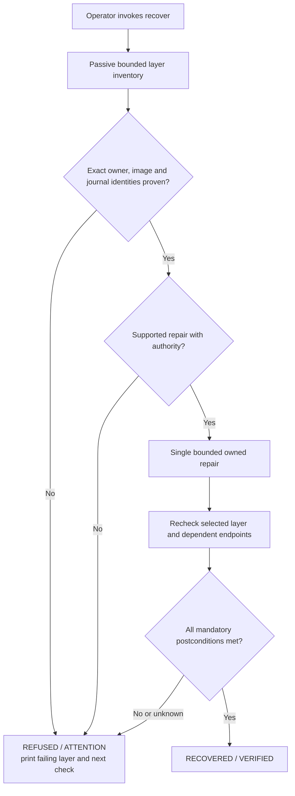

# CatDesk — Release, Diagnostics and Recovery

**Decision 2026-11-16T00:34:15.175115+00:00:** The source-candidate observer was built separately and live-qualified without changing selection, immutable retained packages or protected production. One no-send observation preserved 1,724 pins and cleaned all owned processes. Source/live diagnostic evidence does not supply independent review verdicts, signed installer authority or complete Web coding acceptance. [Evidence](../verification/FROZEN_REQUEST_OBSERVATION_2026_11_15.json).

**Decision 2026-11-16T00:09:22.940282+00:00:** The runtime-access failure was repaired through its approved resource-owner procedure without a CatDesk/Wake promotion. Actual interpreter version execution passed; the selected development package and protected production release remain unchanged. Source budget readback passed four targeted regressions, Clippy and formatting; it is not independently reviewed release authority. [Evidence](../verification/NATIVE_RUNTIME_REPAIR_APPLIED_2026_11_15.json).

**Decision 2026-11-15T22:34:51Z:** No backend or Wake upgrade is needed to address the native interpreter permission dependency. A frozen owner-scoped read/execute repair is preflight-ready, not executed; genuine protected release/review gates still apply to separate missing installed Web capabilities. [Evidence](../verification/NATIVE_RUNTIME_READ_ACCESS_2026_11_15.json).

**Decision 2026-11-15T21:34:58Z:** Native diagnostic probes qualify only their exact runtime layers. No candidate rebuild/selection or protected upgrade occurred; existing frozen production, fallback and canonical v5 remain unchanged. Interpreter qualification is a separate unresolved local dependency. [Evidence](../verification/NATIVE_SANDBOX_READINESS_AND_COMMAND_QUALIFICATION_2026_11_15.json).

**Decision 2026-11-15T21:01:12Z:** This source-only diagnostic change does not rebuild/select a package or confer promotion authority. Selected development app remains 79a449b, prior verified fallback is retained, and production/v5 stay unchanged. [Evidence](../verification/NATIVE_COMMAND_FAILURE_DIAGNOSTIC_2026_11_15.json).

**Source validation 2026-11-15T20:32:08Z:** retained proposal operations are now checked against their original full diff hash within the existing non-writing recovery validation. This adds no tool call, replay, authority, install or service. Source `9d96f8e32f3fdf8b528d15eda453e9398f74a392` passes eight native recovery tests and strict checks; selected live test app remains source `79a449b`.

**Decision 2026-11-15T20:23:03Z:** Current development source 79a449b was built and selected through the existing unprotected package transaction with the previous verified 947aeda fallback retained. Its backend/recovery/edit/Wake parts have live evidence, but the native verifier failed; do not mark the whole candidate healthy or confer protected release authority. Production and the single canonical v5 interface are unchanged. Preserve failed receipts and continue eligible work; do not treat ordinary development as production promotion. See [dated proof](../verification/SETTLED_READ_ONLY_TASK_RECOVERY_2026_11_15.json).

**Release-model clarification 2026-11-15T19:33:36Z:** one system and one unchanged canonical v5 interface. Frozen independently verified releases are production; authorized source/worktrees/builds and isolated local fixture tests are development. Reuse current selection, immutable artifacts, existing fallback/promotion/rollback and bounded owners. No new installation, release manager, tunnel, plugin, external connection or backend infrastructure. Local source work proceeds independently of protected-release acceptance.

## 2026-11-15T19:18:45Z — Development/production separation decision

Unprotected development package updates and local verification records are independent of protected installer/broker/signing authority. The existing transaction preserves immutable versions and a previously verified fallback; new health must be measured before recording a working current package. Compiled script identity checks remain strict: use a controller from matching source instead of weakening them. Current package selection, authenticated local health and cleanup are qualified; protected promotion and fresh remote Web acceptance are not implied. The canonical external v5 connection remains unchanged. Missing installed delivery/Git/adapter capabilities are handled by the existing genuine reviewed release process, not a development tunnel or silent rerouting. See [dated qualification](../verification/DEVELOPMENT_PRODUCTION_SEPARATION_2026_11_15.json) and [current handoff](../../CATDESK_PROJECT_HANDOFF.md) for exact maturity and remaining gates.

> **Revision timestamp (UTC):** `2026-11-14T18:47:56Z` · **Status:** Reviewed consolidation reference; does not authorize an installation, privileged broker operation, signer creation or recovery action.
> **Contract:** Simple operator experience with conservative, evidence-driven restore. For architecture see [CATDESK_ARCHITECTURE.md](CATDESK_ARCHITECTURE.md); for security and journal prohibitions see [CATDESK_SECURITY_MODEL.md](CATDESK_SECURITY_MODEL.md).

## 1. User experience: `recover` and `diagnose`

The existing Windows lifecycle entry point is deliberately reused:

```text
.\catdesk.ps1 diagnose   # identify the failed layer; read-only
.\catdesk.ps1 recover    # existing guarded recovery; authorization still required
```

Use the qualified checkout, executable fingerprint and parameters in root [CATDESK_IMPORTANT_COMMANDS.md](../../CATDESK_IMPORTANT_COMMANDS.md). These command names identify the existing interface; they do not establish current readiness or grant recovery authority. Do not introduce a second launcher to match a proposed UX.

**Operator expectation:** A failed instance should either (a) resume automatically/with one command through an existing trusted release and supported owner transitions, or (b) print a concise, actionable failing-layer report without hidden resets or repeated manual incantations. An upstream 429, absent browser editor, mismatched release manifest and stale project target are distinct errors and must not all be called “CatDesk down.”

## 2. Layered health model

Diagnostics should run from a trusted launcher even when the normal CatDesk backend is unavailable. Distinguish inspection from repair and mark unobserved layers `UNVERIFIED`, not green.

| Layer | Passive checks | Eligible restoration boundary | Common refusal |
|---|---|---|---|
| 0. Source/launcher | Qualified launcher, selected script and repository identity | Use vetted installed launcher or standalone diagnostic | Unknown script identity; source checkout ≠ selected binary |
| 1. Installed release | Current pointer, immutable image/manifest SHA, LKG record and trusted receipt | Existing reviewed release/rollback transaction only | `LKG_AUTHORITY_MISSING`, hash/physical identity drift |
| 2. Local backend | Running owner, configured loopback endpoint, authenticated MCP initialize/catalog and process/job handle | Bounded authorized stop/start, no competing owner | Owner mismatch, port contention, protected state uncertain |
| 3. MCP authentication | Bearer matrix, initialize/catalog, declared tool availability | Fix known local config through supported path only | Wrong/missing bearer; unsupported installed catalog |
| 4. Official tunnel | Existing external runtime process/alias/route health, upstream reachability | **Operator/external runtime owns restart**; no duplicate tunnel | Upstream 429, 424, transient connector rejection |
| 5. Project registry | Project ID, workspace, target URL/digest/generation, original task grant | Existing guarded paired-target CAS only | Registry/Wake mismatch, invalid URL, stale generation |
| 6. WakeHost | Immutable selected package/hash, lease, desired vs actual state, queue and last exit reason | `start_installed`/supported lifecycle under original owner | Installed dev.84 parser incompatibility; broker/first-generation migration hold |
| 7. Browser/SeleniumBase | Authenticated operator profile, exact tab/URL/editor, draft/submit boundary | Bounded existing owner/login recovery, not new profile by default | `EDITOR_MISSING`, login/CAPTCHA, uncertain submit |
| 8. Task execution | Active/queued projects, task journal, workspace, claimed/SENT/unknown receipts | Resume *original* admitted task at permitted boundary | Held unknown effect; foreign project/owner |
| 9. Turn/context | Timer ID/status, pending manual Wake, context coverage, rollover phase | Original timer/journal reconciliation and safeguarded continuation | Time expired before intent; truncated context; unknown successor creation |
| 10. Optional providers | Codex CLI login/session vs actual model availability; Ollama/Qwen status | Explicit provider-specific policy only | Quota exhaustion is not a core Web-execution failure |
| 11. Operator GUI | UI owner, displayed projects/status, stale readback | Open/refresh qualified GUI without altering Wake | Backend healthy but GUI absent or frozen |

A diagnostic report should include at least `{timestampUtc, layer, status, reasonCode, checkedOwner, selectedArtifact, evidenceRef, recoveryEligibility, nextAction}`. Redact credentials, private routes and personal paths. Overall status is **not healthy** if a required layer is unknown. Distinguish an intentionally stopped optional component from a failed required component.

The standalone backend and official tunnel runtime have different routers. Inspect `/healthz` and `/readyz` only on an owner that actually publishes them; their historical official-runtime success is not evidence that the standalone port exposes those paths. A stale Wake `status.json` is an observation, not proof of a live host lease. Current source annotates its age separately; older installed binaries may return only the historical projection.

## 3. Recovery flow and stop conditions



**Algorithmic obligations:**

1. **Read-only preflight:** determine root alias/physical identity, the actually installed image/manifest, active owner PID *plus* originating handle/lease, task/target journals and pending releases. No new processes or files from a passive doctor apart from safely bounded audit logs where existing implementations require them.
2. **Classify:** local fault, external tunnel/provider, protected release fault, missing authority, browser attention, task unknown, user input required, or stale probe.
3. **Select supported recovery:** Only use existing lifecycle primitives with real independent authority. Do not mint signing keys, reinterpret expired approvals, trust a PID alone, or rebuild source as protected release.
4. **Bound work:** one owner, time budget, cooldown, immutable selected executable, Job/child cleanup and persistent attempt record. Do not create two live listeners or two browser owners to “fix” a timeout.
5. **Verify result:** fresh exact endpoint/owner and project/Wake target readback; authentic MCP for backend; correct same immutable selected binary; no mutation to unrelated projects, original receipts, LKG or external tunnel profile.
6. **Report honestly:** `RECOVERED`, `PARTIAL`, `REFUSED`, `ATTENTION`, `UNVERIFIED`, or `EXTERNAL_UNAVAILABLE`, each with next actionable check and stopped/remaining owners. Repeating an unknown side effect is prohibited.

**Important distinction:** A recover command is not allowed to repair every failure automatically. Where a trust, signing, elevation, pair-identity, browser login or irreversible submit boundary cannot be established, **fast and clear refusal is correct behavior**.

## 4. Three lanes and source promotion

| Lane | Purpose | Permitted behavior | Not proof of |
|---|---|---|---|
| **Development source/worktree** | Feature branches, tests, review, CI and ordinary local tools | Isolated non-elevated development in registered workspaces, source publication | Installed runtime capability or protected release permission |
| **Independent Wake lifecycle** | Selected WakeHost package, browser profile, queue and durable paired targets | Supported status/start/pause/resume/stop/retire and reviewed protected broker path | Permission to use mutable compiler output or bypass store migration |
| **Protected production release** | Stable CatDesk executable, manifest, verified current/LKG and guarded rollback | Separately authorized immutable build/review/producer/promotion with owner stop/start | Automatic self-promotion because GitHub PR or unit tests passed |

`main` is intended as a reviewed stable **source** line, but a Git tag or branch head is not a protected installed binary. Active development branches may be more advanced. The current installed executable can be older than source and can reject commands present only in new source.

**Git best practice:** commit feature work in isolated branches/worktrees, verify exact remote SHA, use reviewed PR into development/integration, advance `main` only after independent stable-release acceptance. Never `git add -A` across unrelated agents' worktrees, force-push, reset away unknown changes or treat a passing local test as release authorization.

## 5. Current known recovery complexities (dated, not live conclusions)

The existing project has encountered: canonical binary/manifest mismatch, selected package root versus package cache divergence, `SUPERVISOR_ROOT_UNAVAILABLE`, `LKG_AUTHORITY_MISSING`, inconsistent Wake installed-store identity, missing qualified signer/issuer for protected Wake migration, dev.84 URL parser refusal (`TARGET_INVALID_URL`), 429 from the upstream connector, ambiguous browser send and task completion without durable readback. These are **different** classes of failure.

The November 10 source documents note that a development Wake package D could parse the retained URL and pass bounded PAUSED/authenticated local tests while installed dev.84 refused. That is *development evidence*, not protected installation, live successful self-Wake or proof that the selected physical store is coherent.

A local v5 transport check on November 14 returned a serving binary SHA matching its canonical release and a configured but not end-to-end verified tunnel. This does not supersede new current readbacks. Even when local backend and tunnel are running, the browser may be in ATTENTION and Web task execution may be unverified.

### Historical success, current attention and interpretation

The [architecture historical evidence](CATDESK_ARCHITECTURE.md#historical-acceptance-preserved--single-chat-wake-and-timer) records a previously working manual Wake USER delivery and 18m56s timer STOP. Restoration of that **single-chat capability** should be a first regression gate; it should not be described as an entirely missing feature. The current v5 Wake status is not a clean live pass: one current direct status response reported `STOPPED`/PID 0 with `STATE_REPLACE_FAILED` retained, while a transport-derived snapshot reported `RUNNING`. Before restart, inspect trusted current owner lease and immutable selected package, distinguish freshness/projection and preserve the older `SUBMITTING` event without replay. The officially served backend SHA parity being `MATCH` does not settle WakeHost browser ownership.

**QA review 2026-11-14T19:07:55Z:** This is a dated diagnostic interpretation, not a protected repair authorization. The supported command spellings and correct owner must be established from the selected installed runtime, not an old Markdown command example.

### Development-only exclusion-root view reconciliation

**Decision, 2026-11-14T21:56:49Z:** a nonprivileged development runtime may reconcile the precise known package-alias split without promoting a binary or repairing either protected installation. Admission requires that both recorded spellings originally identified one directory, the explicit package-cache path still identifies that retained object, and the direct spelling now identifies a different directory outside the development workspace/runtime. A lost anchor, missing root, arbitrary root replacement, changed package, active owner or unknown profile owner must refuse. Ordinary selection keeps its strict identity check.

The existing development operator facade provides a hash-bound preflight and explicit execution transition. Reuse backend/project/host/browser leases and the bounded profile-quiescence observer. Freeze the original authority hash and observed root-view hash; atomically replace only the unprotected development authority's exclusion-root list, retaining its original bytes under their hash. Package pointer, executable/manifest fingerprints, profile, authentication, targets, task journals and protected roots remain unchanged. Recognize an exact already-committed result read-only after interruption; never infer authority from a newly matching checksum. This is not T-0485 migration, signer enrollment, protected release approval or live Wake acceptance. Source and actual runtime qualification are recorded separately in the root activity log.

## 6. Crash and interruption contracts

| Failure moment | Safe recovery | Must not happen |
|---|---|---|
| Before local task/intent commit | Validate absence under original journal; start once if admission allows | Fabricate a prior completed result |
| After journal commit, before browser submit | Reuse original event and revalidate exact target/lease | Create a new equivalent event to bypass a hold |
| During/after Web submission but before receipt | Hold UNKNOWN; inspect original target and UI read-only | Blind resend or click Retry |
| After confirmed USER append | Observe original assistant response | Submit same USER again |
| After file change but before verification receipt | Compare actual Git/worktree and original tool journal | Repeat possibly non-idempotent edit or claim tests passed |
| During rollover creation | Reconcile exact issued URL/bootstrap and original journal | Create another successor without checking old one |
| During protected pointer transition | Use original frozen transaction/marker/receipt with independent trust | Write a new current.json/LKG or skip a failed admission |
| After process failure | Only one qualified existing owner may restart immutable selected artifact | Kill foreign/external tunnel process or race another WakeHost |

Global startup, release/promotion and browser leases must be separate; one status command is never a broad mutation permit. Stop/cleanup should prove whole owned Job/tree exit where required and never assume a timed-out command produced no external effect.

## 7. One-command acceptance tests

**Diagnostic acceptance:** fault or simulate each layer independently; `diagnose` returns the correct layer and reason without a write, process start or secret exposure. Distinguish external rate limits from backend failure. The operator should not need to read giant logs to understand the next step.

**Recovery acceptance:** for eligible failures, one recover action returns the original verified identity and resumes an approved task; for protected, external or UNKNOWN failures it refuses precisely. Test startup failure, port occupied, invalid manifest, missing LKG, store path alias, browser missing editor, tunnel disconnect, stale registry and orphan-owner ambiguity. Include reboot, interrupted upgrade and immediate second attempt. No duplicate process, USER send or task execution.

**Release acceptance:** reproducible exact source SHA and build evidence, code review, tests, independent authority, stopped predecessor, protected swap, health readback and tested rollback. A build from source is not enough; source, selected development binary, installed canonical image and official tunnel have independent identities.

## 8. Revision and operating references

**Decision recorded at `2026-11-14T18:47:56Z`:** make recover/diagnose a first-class operator experience while preserving current release authority separation and external tunnel ownership. Changes to process authority, release/rollback rules or installation require their own dated milestone/ticket and independent review; ordinary incident outcomes go into the root activity log, not this architecture file.

Relevant legacy/current files: [prior architecture](../orchestrator/CANONICAL_CURRENT_ARCHITECTURE.md), [three-lane design](../orchestrator/CATDESK_SIMPLIFIED_DEV_RELEASE_WAKE_MODEL.md), [release lifecycle](../orchestrator/CATDESK_PRODUCTION_RELEASE_LIFECYCLE.md), [T-0485 Wake broker](../orchestrator/tickets/T-0485_WAKE_PROTECTED_INSTALL_BROKER.md), [transport design](../tunnel/STABLE_MCP_TRANSPORT_ARCHITECTURE.md), and [root commands](../../CATDESK_IMPORTANT_COMMANDS.md). Historical status is evidence only and cannot supply fresh trust.
